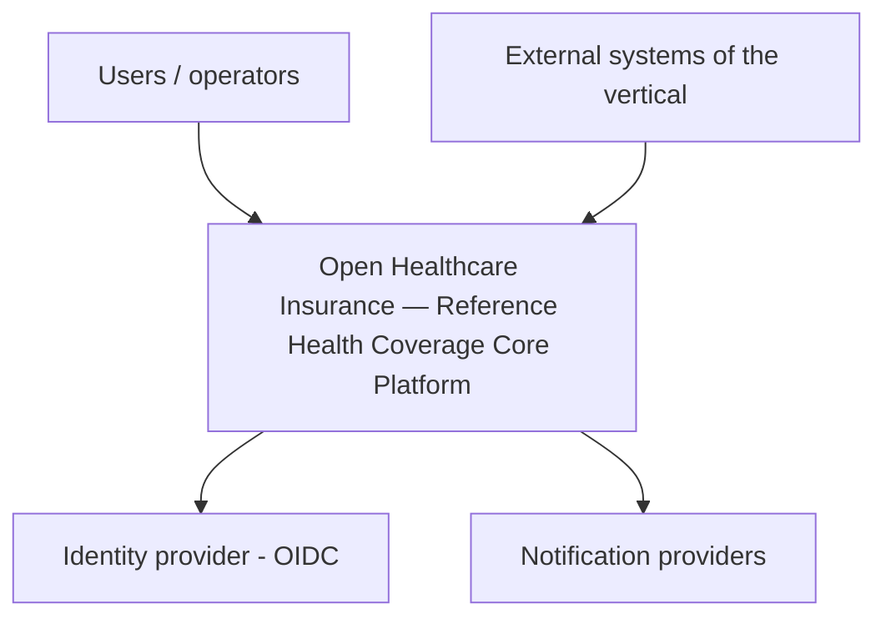
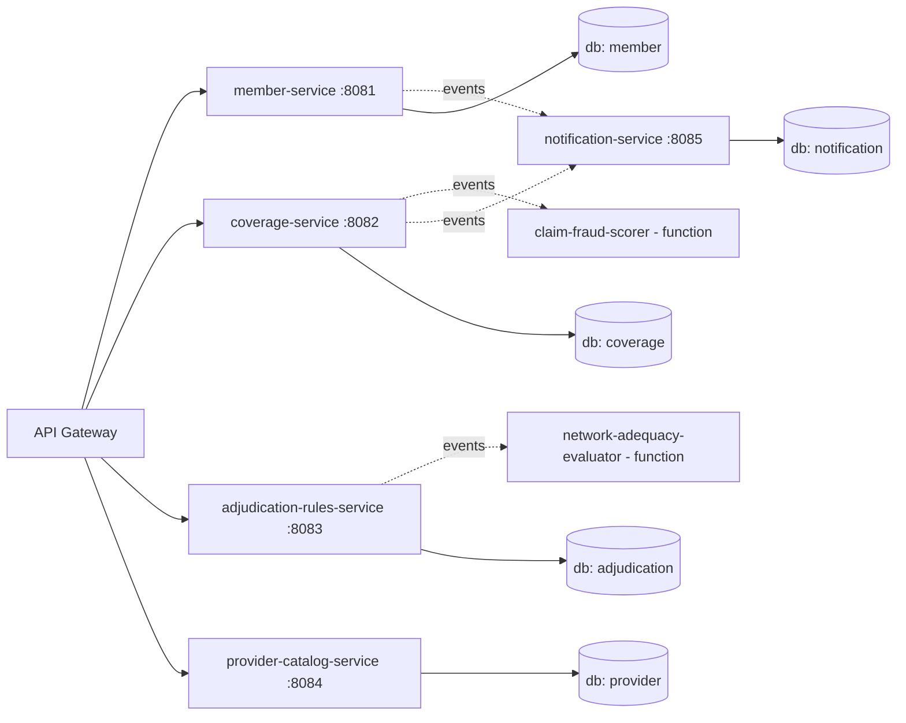
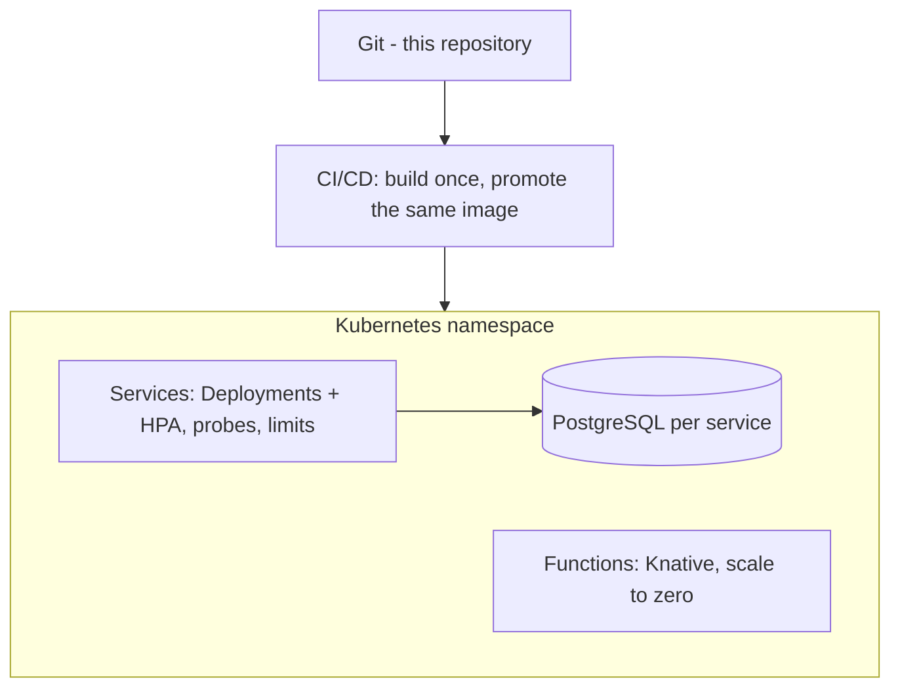
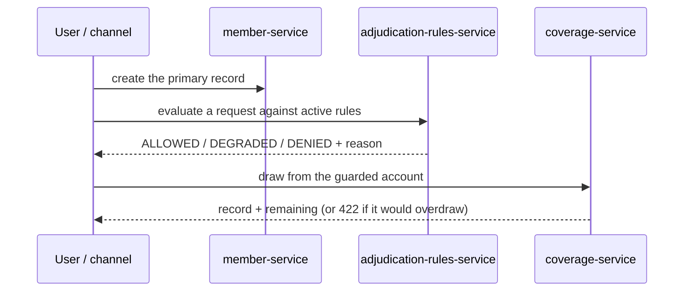

# Architecture Diagrams

Mermaid views governed by the viewpoints of `architecture-description.md` (ISO/IEC/IEEE 42010).

## D-1 — System Context (C4 Level 1)

## D-2 — Containers (C4 Level 2)

## D-3 — Deployment

## D-4 — Core flow (sequence)

