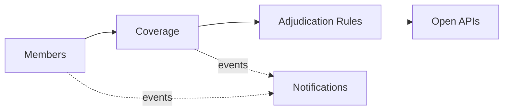

# Domain Model and Bounded Contexts

Ubiquitous language and context design (view VP-4). Domain-standard concepts are mapped
normatively in `../domain/domain-standards.md` (CR-5).

## Ubiquitous language (selected terms)

| Term | Meaning |
|---|---|
| **Member** | A covered person; the member number is masked by construction |
| **Coverage account** | A member's guarded coverage-limit account, in minor units |
| **Claim payment** | One payment against coverage, by claim type |
| **Adjudication rule** | A decision rule binding a claim type to amount and processing envelopes |
| **Provider** | A contracted hospital, clinic, pharmacy or lab |
| **Claim fraud score** | A transparent 0-100 claim risk score |

## Bounded contexts and invariants

### Members — `member-service`
Member registry; the member number is masked at enrolment and never kept in clear. Lifecycle: `ACTIVE` → transitions
suspend, terminate. Health data is the most sensitive class this program handles: member numbers are validated and never stored or returned in clear (masked only), no clinical data is stored by this core at all, and every record here is synthetic. HIPAA alignment is a posture for adopters' BAAs and safeguards, not a certification.

### Coverage — `coverage-service`
Guarded coverage-limit accounts per member and the claim payments against them. **Invariant (ADR-0004): claim payments against a member's coverage account never exceed the coverage limit — a payment that would overrun it is rejected (422) and records nothing.** Consumption records are
append-only evidence; a rejected operation records nothing.

### Adjudication Rules — `adjudication-rules-service`
Decision rules binding claim types to amount and processing envelopes, with reasons. Only ACTIVE rules decide; evaluation order is by priority; every decision
is ALLOWED / DEGRADED / DENIED with the matched rule and a human-readable reason.

### Providers — `provider-catalog-service`
Contracted provider network catalogue.

### Notifications — `notification-service`
Delivery trail for audit; recipients are never logged.

## Context map

