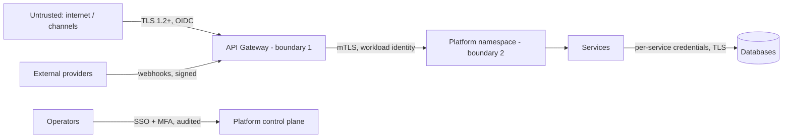

# Security Architecture

Security viewpoint (VP-7). The management system is ISO/IEC 27001; controls are mapped to
ISO/IEC 27002 in `iso-27001-27002-control-mapping.md`; the threat model is in
`threat-model.md`.

## 1. Trust boundaries

## 2. Identity, data protection, application rules

- Consumers: OAuth 2.1 + PKCE against the adopter's IdP; gateway validates JWTs
  (`OIDC_ISSUER` is configuration). Service-to-service: mTLS; deny-by-default policies.
- Data protection: Health data is the most sensitive class this program handles: member numbers are validated and never stored or returned in clear (masked only), no clinical data is stored by this core at all, and every record here is synthetic. HIPAA alignment is a posture for adopters' BAAs and safeguards, not a certification. Secrets: platform secret store only, injected as
  environment variables; CI secret scanning; no secrets in this repository.
- Application rules (binding): input validation on every DTO; RFC 9457 errors without
  internals; idempotency on creates; audit logging (actor, timestamp, correlation id,
  business reference) on every state change; BOM-managed dependencies scanned in CI.
